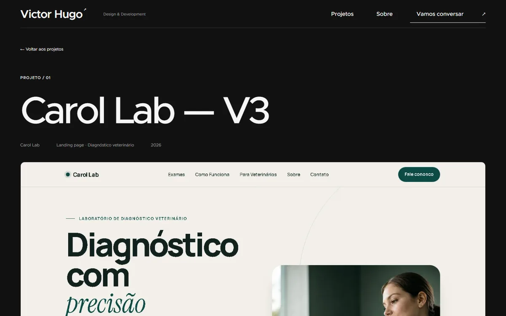
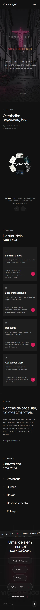

# Victor Hugo — Portfólio

Portfólio de **web design e desenvolvimento**, criado por Victor Hugo Corrêa para apresentar projetos, serviços e formas de contato profissional.

**[Visitar portfólio](https://victor-hugo-portfolio-mocha.vercel.app/)** · **[LinkedIn](https://www.linkedin.com/in/victor-hn-correa)** · **[GitHub](https://github.com/CorreaVictorHugo)**


## Sobre o projeto

A interface apresenta uma seleção de trabalhos, com páginas individuais para explicar contexto, desafio, solução e entrega. O visual combina tipografia editorial, animação do nome em SVG e uma roda interativa de projetos em 3D.

- Página inicial com projetos, apresentação, serviços, processo e contato.
- Navegação entre a seleção de projetos e seus estudos de caso.
- Animações com GSAP e transições entre páginas quando suportadas pelo navegador.
- Layout para computador e celular, com preferência de redução de movimento.
- Conteúdo de projetos e contatos centralizado em arquivos TypeScript.

Os estudos de caso descrevem o escopo das entregas; não atribuem métricas comerciais não verificadas aos projetos.

## Capturas

<details>
<summary>Ver projetos, estudo de caso e versão móvel</summary>

### Seleção de projetos


### Estudo de caso



### Celular



</details>

## Tecnologias

| Área | Tecnologia |
| --- | --- |
| Interface | React e TypeScript |
| Desenvolvimento e build | Vite |
| Rotas | React Router |
| Animação | GSAP, requestAnimationFrame e View Transitions API |
| Estilos | CSS com variáveis de design |
| Imagens | Arquivos locais com capas responsivas em WebP |
| Hospedagem | Vercel |

As versões exatas das dependências estão registradas em `package-lock.json`.

## Executar localmente

Requer **Node.js 22.12 ou superior** e npm. Node.js 24 foi utilizado na validação do projeto.

```bash
git clone https://github.com/CorreaVictorHugo/victor-hugo-portfolio.git
cd victor-hugo-portfolio
npm ci
npm run dev
```

Acesse o endereço indicado pelo Vite no terminal, normalmente `http://localhost:5173`.

| Comando | Finalidade |
| --- | --- |
| `npm run dev` | Servidor local de desenvolvimento |
| `npm run lint` | Análise estática com ESLint |
| `npm run build` | Conferência de tipos e geração da versão de produção em `dist/` |
| `npm run preview` | Prévia local do build de produção |

O projeto não exige variáveis de ambiente para executar localmente. Fontes carregadas pelo Google Fonts dependem de conexão com a internet.

## Estrutura

```text
src/
  app/           Configuração das rotas
  components/    Hero, layout, projetos, serviços e elementos de interface
  content/       Textos, contatos e lista de projetos
  motion/        Animação, transições e redução de movimento
  pages/         Página inicial, estudos de caso e página não encontrada
  styles/        Variáveis de design e estilos globais
  types/         Tipos dos dados de projeto
public/          Favicon, imagem de abertura e imagens dos projetos
media/           Capturas usadas neste README
docs/            Guia de manutenção e publicação
```

## Atualizar o conteúdo

- **Contatos e textos:** `src/content/site.ts`.
- **Projetos e estudos de caso:** `src/content/projects.ts`.
- **Imagens:** `public/images/projects/`.

Consulte o [guia de manutenção](docs/MANUTENCAO.md) para incluir projetos, configurar contatos e publicar. GitHub e LinkedIn estão configurados; os demais canais são opcionais e devem ser preenchidos apenas com dados confirmados.

## Autoria e direitos de uso

Desenvolvido por **Victor Hugo Corrêa**. Para conversar sobre um projeto, entre em contato pelo **[LinkedIn](https://www.linkedin.com/in/victor-hn-correa)**.

As marcas, imagens e materiais dos trabalhos apresentados pertencem aos respectivos titulares. Este repositório apresenta o portfólio e não declara licença de software livre nem concede direitos de reutilização sobre os materiais de clientes.
